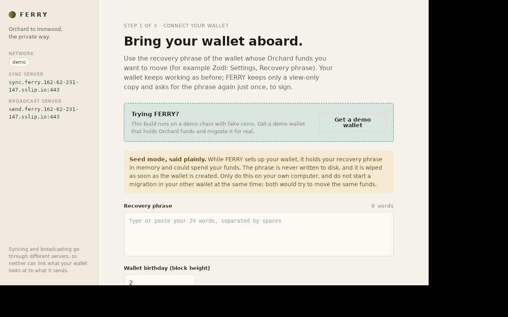
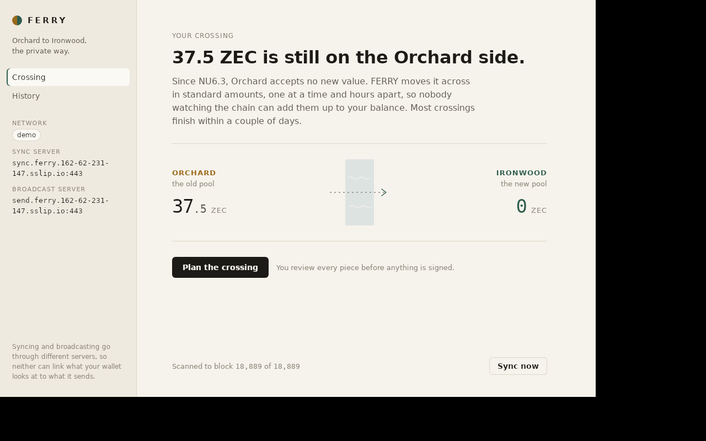
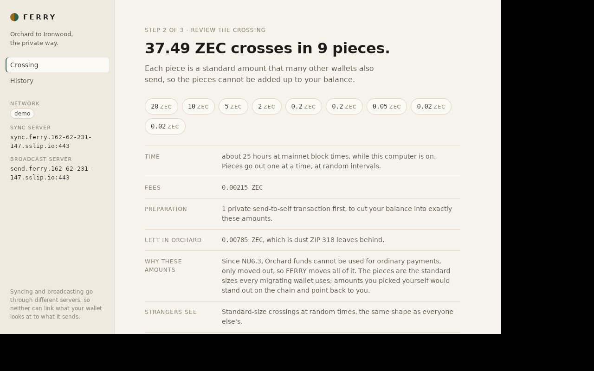
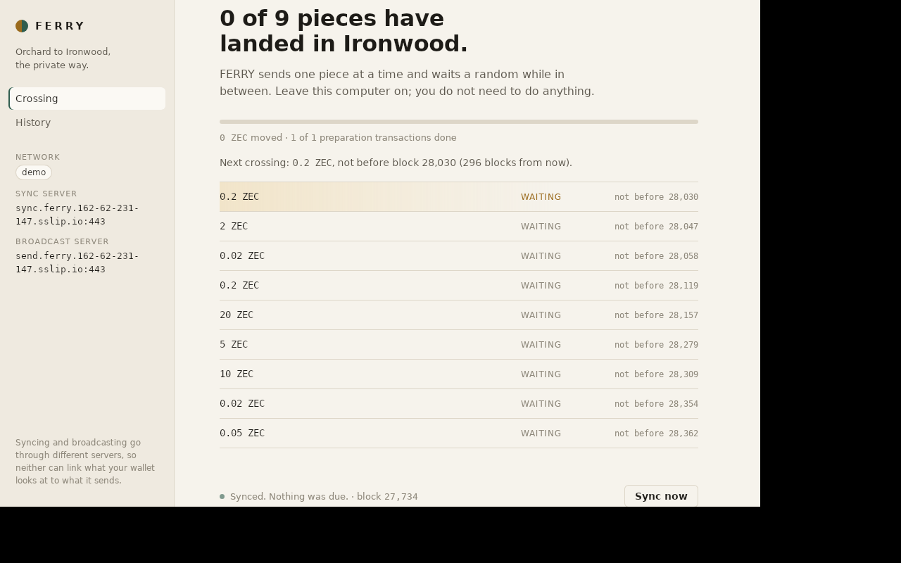
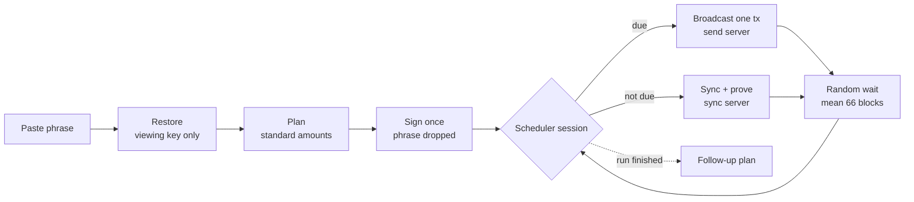
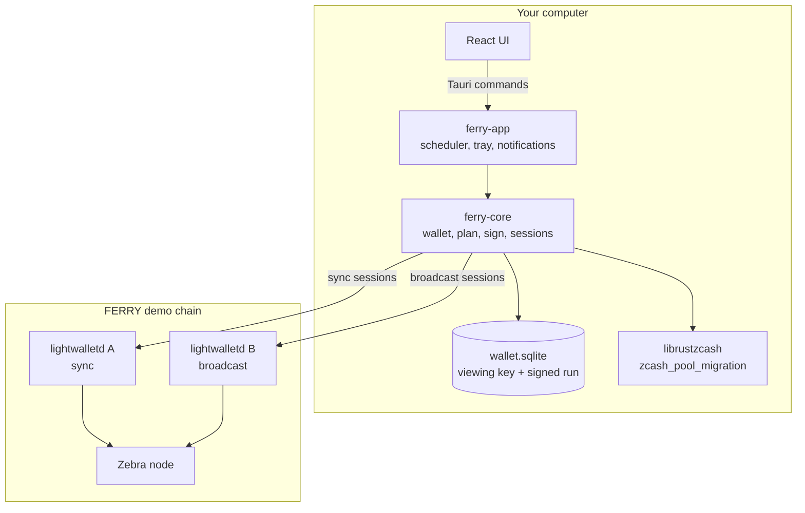

# FERRY


-blue)


**Move your ZEC from Orchard to Ironwood without showing anyone your balance.**

Since NU6.3 (ZIP 258), the Orchard pool accepts no new value: funds there can only be moved out, and the obvious way to move them is one transaction whose amount is public.
FERRY is a desktop app that moves them the private way described in ZIP 318: your balance is cut into standard amounts that every migrating wallet uses, signed once, and sent one piece at a time at random intervals, through a broadcast server that is not the one the wallet syncs from.
It runs on your own computer, because whatever runs the migration holds a viewing key to your whole wallet.

Landing page: https://ferry-rose.vercel.app · Downloads: [GitHub releases](https://github.com/Saber1Y/ferry/releases/latest) · Runs on the hosted FERRY demo chain (fake coins).

[Try it](#see-it-in-one-download) · [Why it matters](#the-one-rule) · [Architecture](#architecture) · [Evidence](#whats-real-vs-pending) · [Run it locally](#run-it-locally)

Built for Zecathon 2026, Core & Tooling track. Licensed MIT OR Apache-2.0.
FERRY is not a custodial service: it never holds your funds, and it is a hackathon build that has not run on mainnet.

## Table of contents

- [See it in one download](#see-it-in-one-download)
- [Screenshots](#screenshots)
- [The one rule](#the-one-rule)
- [What FERRY does](#what-ferry-does)
  - [Connect a wallet without keeping its phrase](#connect-a-wallet-without-keeping-its-phrase)
  - [Plan in standard amounts](#plan-in-standard-amounts)
  - [Sign once](#sign-once)
  - [Cross at random, through a separate server](#cross-at-random-through-a-separate-server)
  - [Catch up after a closed laptop](#catch-up-after-a-closed-laptop)
  - [Follow-up runs and history](#follow-up-runs-and-history)
- [Architecture](#architecture)
- [Component by component](#component-by-component)
- [Safety, enforced in code](#safety-enforced-in-code)
- [How it uses Zcash](#how-it-uses-zcash)
- [Engineering decisions and the hard problems](#engineering-decisions-and-the-hard-problems)
- [What's real vs pending](#whats-real-vs-pending)
- [Tests](#tests)
- [Run it locally](#run-it-locally)
  - [1. The local regtest chain](#1-the-local-regtest-chain)
  - [2. The desktop app](#2-the-desktop-app)
  - [3. Installers](#3-installers)
- [The one-flow demo](#the-one-flow-demo)
- [Configuration](#configuration)
- [Deploy](#deploy)
- [Project layout](#project-layout)
- [Tech stack, credits, roadmap](#tech-stack-credits-roadmap)
- [Disclaimer and license](#disclaimer-and-license)

## See it in one download

Download the installer for your computer from the [latest release](https://github.com/Saber1Y/ferry/releases/latest):

| System | File |
| --- | --- |
| macOS, Apple silicon | `FERRY_<version>_aarch64.dmg` |
| macOS, Intel | `FERRY_<version>_x64.dmg` |
| Windows 10 and 11 | `FERRY_<version>_x64-setup.exe` |
| Linux, Debian and Ubuntu | `FERRY_<version>_amd64.deb` |
| Linux, any distribution | `FERRY_<version>_amd64.AppImage` |

The installers are not signed yet.
On macOS, right-click FERRY in Applications and choose Open; on Windows, click More info, then Run anyway.

Then open FERRY, click **Get a demo wallet**, restore it, click **Plan the crossing**, review the pieces, and sign.
The app sends the pieces by itself over the next two hours or so: the demo chain makes a block about every 10 seconds instead of 75.

## Screenshots









These come from the Linux build on the hosted demo chain ([demo chain run 1](evidence/demo-chain-run-1)).

## The one rule

**Nothing on the chain may add up to your balance.**

A naive migration moves the whole Orchard balance in one transaction, and the amount that crosses into Ironwood is public, so anyone can read your balance to within the fee.
FERRY keeps three things from linking the pieces back together:

1. *Amounts.* Every crossing is a canonical ZIP 318 denomination (n x 10^k), chosen by librustzcash's `zcash_pool_migration` planner, so a crossing looks like everyone else's.
2. *Timing.* Crossings go out one per session, at least one block apart, after an exponential random delay with a mean of 66 blocks (capped at 576), drawn from the operating system's CSPRNG.
3. *Network.* A session either syncs or broadcasts, never both, and the two use different lightwalletd servers, so neither server sees what the wallet looks at and what it sends.

## What FERRY does

### Connect a wallet without keeping its phrase

The user pastes the recovery phrase of the wallet that holds Orchard funds.
FERRY derives the account, stores only its viewing key in a local SQLite wallet, scans the chain from the birthday, and drops the phrase.

```text
phrase -> SecretString -> seed (zeroized) -> account in wallet.sqlite (viewing key only)
```

The phrase never touches disk, and `bip0039` wipes the mnemonic on drop.

### Plan in standard amounts

`plan_migration` asks the engine for a plan and shows every piece, the fees, the preparation transactions, the dust left behind, and how long it takes.

```text
37.49 ZEC crosses in 9 pieces: 20, 10, 5, 2, 0.2, 0.2, 0.05, 0.02, 0.02
fees 0.00215 · 1 preparation transaction · 0.00785 left in Orchard as dust
```

Nothing is signed until the user agrees to that exact plan.

### Sign once

The user enters the phrase a second time.
FERRY checks that it belongs to this wallet (by comparing viewing keys), derives the spending key, has the engine sign every preparation and crossing in one go, and drops the key.

```text
commit_migration(phrase) -> commit_preparation(plan, orchard spending key) -> signed run stored -> key dropped
```

From then on the app can only send what was signed; it cannot spend anything else.

### Cross at random, through a separate server

A background scheduler runs one session at a time.
Each session first checks whether the run has finished, then either broadcasts the one transaction that is due, or syncs and proves what is ready.

```text
session: finished? -> broadcast one due tx (send server) | sync + prove (sync server)
```

Preparations go out as soon as they are ready, because they are shielded sends to self and reveal no amount; crossings wait for their random gate.

### Catch up after a closed laptop

If the computer was off when crossings were due, FERRY sends nothing at launch: it draws a fresh random delay from the current height and spaces the overdue crossings out again, as ZIP 318's "Fallback on application open" requires.
[Regtest run 5](evidence/regtest-run-5) shows it after 120 blocks with the app closed.

### Follow-up runs and history

When fees do not fit in one run, the engine leaves some pieces for later.
FERRY notices the finished run, offers a follow-up plan, and signs it the same way.
Every transaction FERRY sends is kept in a local history with its amount and transaction id.

## Architecture

Two decisions shape everything:

1. **The migration runs on the user's own computer.** Whatever runs it holds a viewing key that shows the whole wallet history, so a hosted service would see exactly what the migration hides from the chain.
2. **The app never writes anything that can spend.** It keeps a viewing key and the signed run; the spending key exists only in memory during the signing call.





| Tier | Runs | Can it move funds? | Responsibility |
| --- | --- | --- | --- |
| React UI | In the app's web view | No | Restore, plan review, signing form, progress, history |
| `ferry-app` | Tauri process on the user's computer | Only what was signed | Commands, background scheduler, tray, notifications |
| `ferry-core` | Inside `ferry-app` | Only during the signing call | Wallet, sync, planning, signing, sessions, history |
| Sync lightwalletd | Demo server | No | Serves compact blocks to sync sessions |
| Broadcast lightwalletd | Demo server | No | Relays the one transaction of a broadcast session |
| Zebra | Demo server | No | The chain itself |

## Component by component

**`crates/ferry-core`** (Rust library)

| Module | Responsibility |
| --- | --- |
| `wallet.rs` | Restore from a phrase into a private folder, open, sync, read balances |
| `migration.rs` | Plan, commit (sign once), progress, scheduler sessions, overdue catch-up, history |
| `network.rs` | Mainnet, testnet and regtest parameters, with the demo chain's activation heights |
| `lightwalletd.rs` | Server addresses and TLS for remote servers |
| `cache.rs` | In-memory block cache for sync |
| `error.rs` | Errors the app can show, such as a wrong phrase or a migration already in progress |

**`app`** (Tauri 2 desktop app)

| File | Responsibility |
| --- | --- |
| `src-tauri/src/lib.rs` | Tauri commands, the scheduler loop, network choice, follow-up detection |
| `src-tauri/src/desktop.rs` | Tray status, show and quit, notifications, start at login |
| `src/Restore.tsx` | Connect a wallet or get a demo wallet |
| `src/Plan.tsx` | Review the plan and sign once |
| `src/Crossing.tsx` | Progress, the next crossing, each piece's state |
| `src/History.tsx` | Everything FERRY has sent |

**Tooling**

| Path | Responsibility |
| --- | --- |
| `regtest/` | A local Zebra chain with two lightwalletd servers, and scripts that fund and drive migrations |
| `observer/observe.py` | Reads the chain like an outsider and flags crossings that could be linked |
| `deploy/demo-server/` | Installs the hosted demo chain: Zebra, two lightwalletd, a block producer, the demo wallet API, Caddy |
| `packaging/` | Builds every installer from one Mac |
| `harness/` | The patch to ECC's `zcash-devtool` that proved the loop before the app existed |

## Safety, enforced in code

| Claim | How it's enforced |
| --- | --- |
| The phrase never touches disk | It arrives as a `SecretString`, the seed is zeroized after deriving the account, `bip0039` wipes the mnemonic on drop, and only the viewing key is stored |
| The phrase is cleared from the UI | Both forms clear their state before the Tauri call returns, also on errors; spell-check and autocomplete are off |
| A wrong phrase cannot sign | `commit_migration` compares the derived viewing key with the wallet's and returns `WrongPhrase` |
| No server sees both sync and broadcast | `run_session` either broadcasts or syncs, and they use different `Server`s |
| At most one transaction per session | `try_broadcast` sends the single due transaction and returns |
| Crossings are spaced at random | `draw_delay` uses an exponential distribution, mean 66, cap 576, minimum 1, from the OS CSPRNG; the gate height is stored in `ferry-next-crossing-height` |
| No burst after a closed laptop | `defer_overdue_crossings` redraws the delay from the current height at launch |
| Other local users cannot read the wallet | Wallet folders are set to `0700` on restore and on open |
| The web view cannot reach the system | Capabilities are `core:default` only; the CSP allows scripts from the app itself and network access only to the demo wallet API |

## How it uses Zcash

**Reads** (sync server): compact blocks for scanning, tree states for the birthday, the chain tip.

**Writes** (broadcast server): preparation transactions (shielded Orchard sends to self) and crossings (Orchard to Ironwood transfers in canonical amounts), one per broadcast session.

The demo chain is a regtest Zebra node with NU6.3 at block 300; its lightwalletd servers are at `sync.ferry.162-62-231-147.sslip.io:443` and `send.ferry.162-62-231-147.sslip.io:443`.
NU6.3 activated on mainnet at block 3,428,143 (in the summer of 2026), so mainnet Orchard holders are migrating now; `ferry-core` carries mainnet's parameters, but the app offers only the demo chain and the local regtest chain in this build.

## Engineering decisions and the hard problems

**The engine is librustzcash's, not ours.** Planning, denominations, preparation layers, proving and broadcast bookkeeping come from `zcash_pool_migration` at rev `eb38d7a`. FERRY's job is to drive it correctly and safely from a desktop app, which is where the leaks happen in practice.

**The "has this run finished?" check comes before the random gate.** It first sat behind the crossing gate, so the app only noticed a finished run when the next random slot opened. It now runs first in every session ([regtest run 5](evidence/regtest-run-5)).

**Only crossings wait for the gate.** Preparations are shielded sends to self that reveal no amount, so delaying them only slowed the run down.

**A closed laptop must not mean a burst.** On launch FERRY sends nothing overdue; it redraws the delay from the current height, which ZIP 318 requires and recommends.

**TLS needed an explicit crypto provider.** Release builds crashed on the first TLS connection to the demo servers until `tonic` was built with `tls-ring`.

**Preparations anchor deeper than the tip.** The wallet does not checkpoint every block, so preparations anchor at the newest Orchard checkpoint at least 3 confirmations deep, as ZIP 318's near-tip anchor depth allows.

**Every installer builds on one Mac.** Windows is cross-compiled with `cargo-xwin` and packaged by NSIS in Docker; Linux builds in an emulated x86-64 Ubuntu container ([packaging](packaging)).

## What's real vs pending

| Capability | Status |
| --- | --- |
| Full migration accepted by a real Zebra node | Real - [regtest runs 1 to 5](evidence) with transaction ids |
| Private migration next to a naive one | Real - [run 2](evidence/regtest-run-2): 13 standard crossings in 13 blocks beside a one-shot 249.99 |
| A person migrating from the app | Real - [run 4](evidence/regtest-run-4) |
| Catch-up after a closed app, follow-up run | Real - [run 5](evidence/regtest-run-5) |
| Released installers on the hosted demo chain | Real - [demo chain run 1](evidence/demo-chain-run-1): Intel macOS and Linux, 20 transactions confirmed |
| Apple silicon macOS installer | Real - migrations on the demo chain |
| Windows installer | Built and checked for missing DLLs; not yet run on Windows |
| Linux AppImage | Built from the same app as the tested `.deb`; not run on its own |
| Mainnet | Not yet established - switched off until it can be tested |
| Tor for server connections | Not yet established - servers can see the user's IP address |
| Signed installers | Not yet established |

On the demo chain the crowd of migrating wallets is small, so standard amounts hide a wallet among few others; on mainnet the crowd is every ZIP 318 wallet migrating at the same time.

## Tests

| Suite | Tests | Covers |
| --- | --- | --- |
| `ferry-core` unit tests | 9 | Server addresses and TLS, transaction ids, the random delay's ZIP 318 bounds, network activation heights, private wallet folders |
| Regtest runs | 5 recorded runs | End-to-end migrations on a real Zebra node, read back with `observer/observe.py` |
| Demo chain run | 1 recorded run | The released Intel macOS and Linux installers, unchanged |

```bash
cargo test -p ferry-core
cargo clippy -p ferry-core --all-targets -- -D warnings
cd app && npm run lint && npm run build
```

## Run it locally

### 1. The local regtest chain

Needs Docker, and lightwalletd v0.5.5 built into `.deps/bin/lightwalletd` (see [harness](harness/README.md)).

```bash
regtest/setup-demo.sh  # Zebra + two lightwalletd, funds Bob and Ada with Orchard coins before NU6.3
regtest/chain.sh height
```

### 2. The desktop app

```bash
cd app
npm ci
npm run tauri dev  # debug builds use the local regtest chain
```

To run against the hosted demo chain instead, start it with `FERRY_NETWORK=demo`.

### 3. Installers

```bash
packaging/build.sh macos-arm
packaging/build.sh macos-intel
XWIN_ACCEPT_LICENSE=1 packaging/build.sh windows  # accepts Microsoft's CRT and SDK license
packaging/build.sh linux
```

See [packaging/README.md](packaging/README.md) for the one-time setup.

## The one-flow demo

1. Open FERRY and click **Get a demo wallet**: a wallet with 37.50 of fake Orchard coins on the demo chain.
2. Tick the box and click **Restore wallet**: the balance appears, scanned to the chain tip.
3. Click **Plan the crossing**: 9 standard pieces, fees, the preparation, the dust, and what strangers and this computer each see.
4. Enter the phrase again, agree, and click **Sign and start**.
5. Close the window: FERRY keeps working from the tray and sends the preparation, then one crossing at a time.
6. Open **History** to see each transaction id; the evidence folders show how to check them on the node.

## Configuration

| Variable | Purpose |
| --- | --- |
| `FERRY_NETWORK` | `demo` for the hosted demo chain, `local` for the local regtest chain; release builds default to `demo`, debug builds to `local` |
| `FERRY_WALLET_DIR` | Use this wallet folder instead of the one in the app's data folder |
| `FERRY_SYNC`, `FERRY_BROADCAST` | `host:port` overrides for the `migrate` example in `crates/ferry-core/examples` |

## Deploy

### Demo chain

`deploy/demo-server/install.sh` installs Zebra (regtest, NU6.3 at block 300), two lightwalletd servers, a block producer that mines every 10 seconds, the demo wallet API and the Caddy sites, as systemd services.
`fund.sh` and `make-wallets.py` create the demo wallets with Orchard funds from before NU6.3.

### Landing page

`site/` is a static page deployed to Vercel:

```bash
cd site
vercel deploy --prod
```

## Project layout

```text
ferry/
├── crates/ferry-core/      # wallet, planning, signing, sessions (Rust)
│   └── examples/           # restore_and_sync and migrate, the same calls the app makes
├── app/                    # Tauri 2 desktop app
│   ├── src/                # React UI
│   └── src-tauri/          # commands, scheduler, tray
├── regtest/                # local Zebra chain and migration drivers
├── observer/               # reads the chain like an outsider
├── evidence/               # recorded runs with transaction ids
├── deploy/demo-server/     # the hosted demo chain
├── packaging/              # installers for macOS, Windows and Linux from one Mac
├── harness/                # zcash-devtool patch used before the app existed
├── site/                   # landing page
└── docs/                   # build plan
```

## Tech stack, credits, roadmap

### Tech stack

Rust, librustzcash (`zcash_pool_migration`, `zcash_client_sqlite`, `zcash_client_backend`, `pczt`), Tauri 2, React and TypeScript, Zebra, lightwalletd, Caddy.

### Credits

The migration engine and wallet libraries are Electric Coin Company's librustzcash; the chain is the Zcash Foundation's Zebra; ZIP 318 defines the private migration FERRY follows.

### Roadmap

- Mainnet, once it can be tested end to end
- Tor for both server connections, so servers cannot see the user's IP address
- Signed installers for macOS and Windows
- A shared crowd: more ZIP 318 wallets migrating in the same windows

## Disclaimer and license

FERRY is a hackathon build for Zecathon 2026.
It has only run on regtest chains with fake coins, it is not audited, and it must not be used with real funds yet.
It never takes custody of funds: it runs on the user's own computer and stores no spending key.

**License: MIT OR Apache-2.0.**
